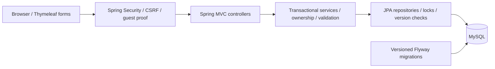
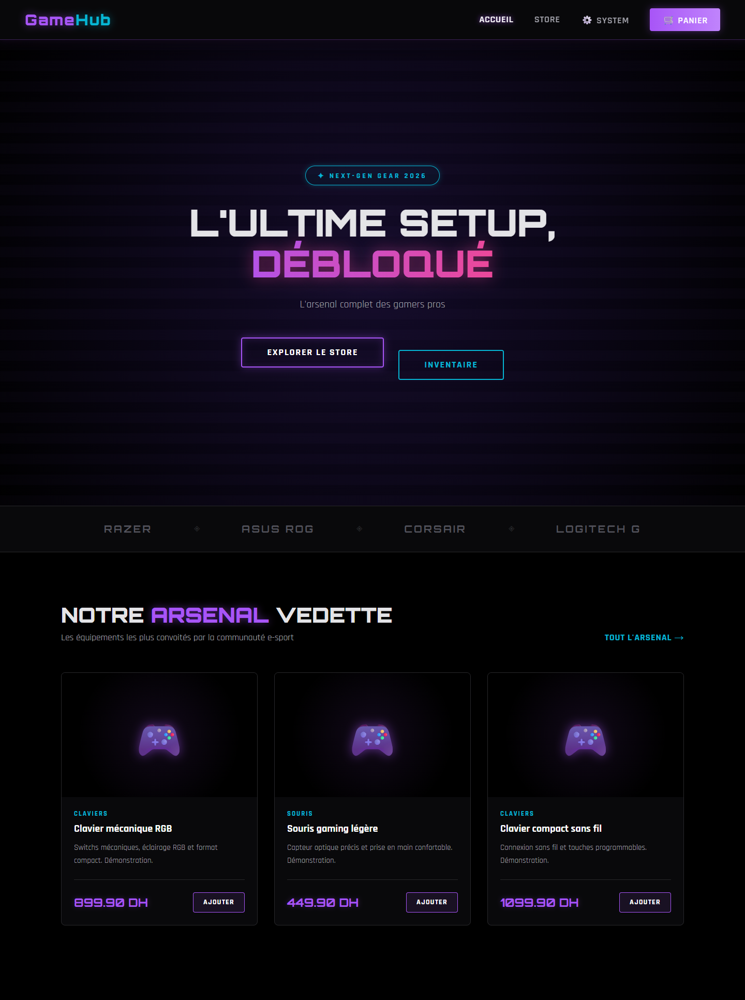
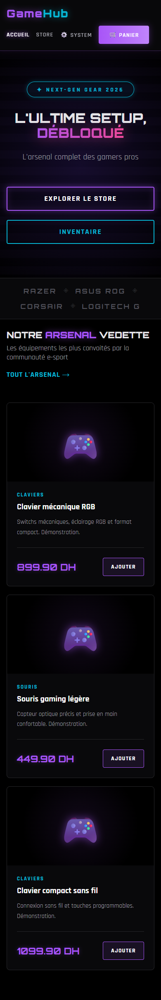
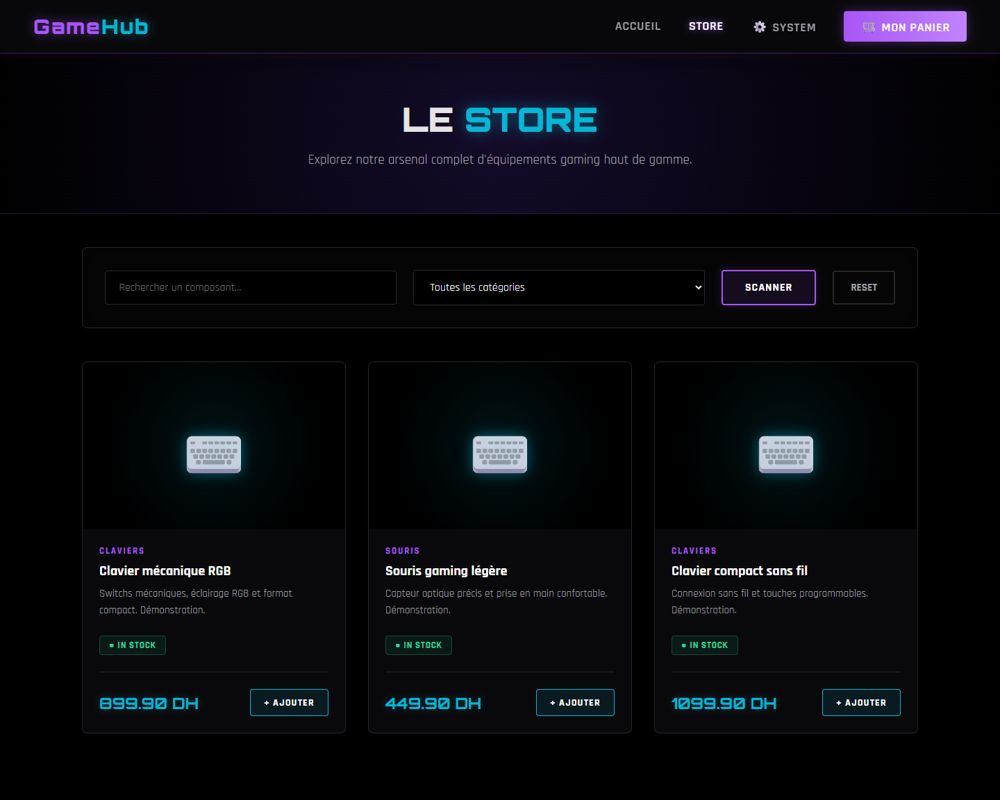
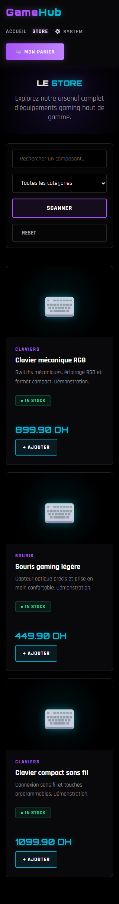
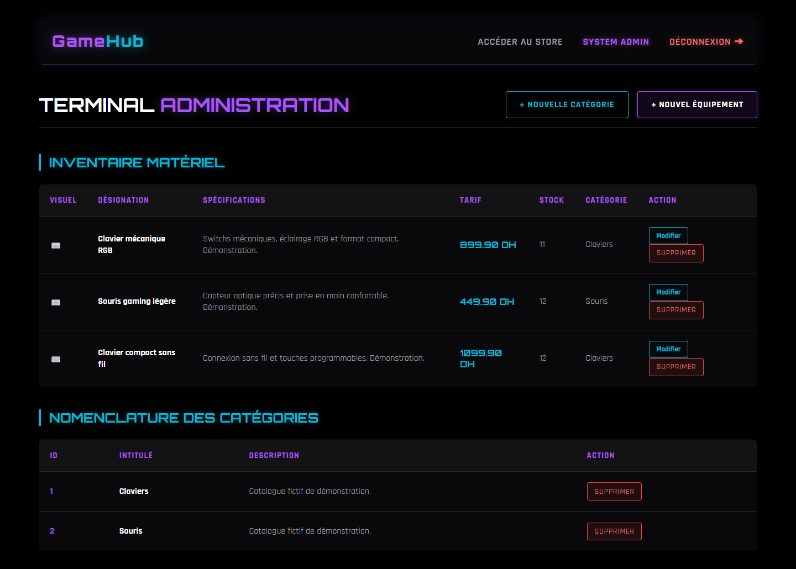
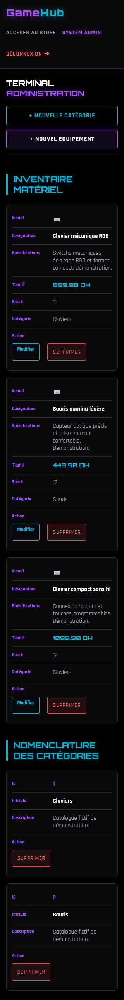

# GameHub

A Java/Spring Boot portfolio project for a French-language gaming storefront. GameHub demonstrates server-rendered MVC, authorization, transactional inventory management and MySQL integration testing. Payments are educational simulations; no money is collected.

## Features

- Public home page, product cards, name search and category filtering. Search takes precedence when both filters are supplied.
- Guest carts without account registration; server-side ownership checks, quantities from 1 to 99, CSRF-protected updates and independent visitor carts.
- Exact two-decimal `BigDecimal` amounts in DH, server-side prices, order-line snapshots and atomic checkout: create order/lines, deduct stock and empty the cart together.
- Durable checkout replay protection: the same checkout key and contact payload return the original owned order, including after HTTP session loss when the guest recovery cookie remains valid. Changed payloads are rejected.
- Owner-only order consultation and simulated payment; foreign or missing orders return 404. Repeated payments cannot create another payment or deduct stock again.
- Cancellation of pending unpaid orders restores stock once. Optional expiry can release abandoned reservations.
- Administrator login with Spring Security and an environment-configured BCrypt credential; product creation/editing/deletion and category creation/deletion. Stale product edits return 409 instead of overwriting newer stock.
- Responsive desktop/mobile layouts preserving the original gaming theme.

Guest recovery uses a random, HttpOnly, SameSite=Lax cookie lasting seven days; only its hash and expiry are stored. Losing this proof prevents recovery. Explicit administrator logout revokes the current guest proof as well.

## Stack

| Component | Version / role |
|---|---|
| Java | Release 17; final local validation used JDK 21.0.10 |
| Spring Boot | 4.0.6 |
| Spring Security | 7.0.5; form login, roles, CSRF |
| Spring MVC / Thymeleaf | Server-rendered pages |
| JPA / Hibernate | Hibernate 7.2.12.Final |
| MySQL | 8.4; validated with 8.4.13 |
| Flyway | 11.14.1; versioned SQL migrations |
| Maven Wrapper | 3.9.15 |
| Tests | JUnit, Spring Boot Test, MockMvc; real disposable MySQL |
| Browser validation | Playwright Core 1.65.0 and installed Microsoft Edge |

## Architecture

The repository root contains `pom.xml`, `src/` and the Maven Wrapper. This is one Maven application, with controllers, services, repositories and entities under `com.example.miniecommerce`.



Payment and cancellation serialize on the owner/order and use conditional state transitions. Product locks, version checks and conditional stock updates protect checkout and administrator writes. No browser-supplied price, total or owner is trusted. Unsupported legacy entity CRUD routes are blocked, including for administrators; supported operations use the guarded application flows.

## Run locally

Prerequisites: JDK 17+, Docker Desktop for isolated verification, or a **new empty** MySQL 8.4 development database. PowerShell scripts require Windows PowerShell, Docker and available network access for initial dependencies. Browser verification also requires Node.js/npm and Microsoft Edge.

The quickest reproducible validation creates its own disposable databases and stops only the containers it created:

```powershell
powershell -NoProfile -ExecutionPolicy Bypass -File tools/Run-IsolatedMysqlTests.ps1 -Package
powershell -NoProfile -ExecutionPolicy Bypass -File tools/Run-IsolatedBrowserChecks.ps1 -Screenshots
```

The second command starts a temporary application, creates fictitious catalogue data and refreshes real screenshots. Generated credentials, logs, browser dependencies and reports remain under ignored `target/`. Do not publish that directory. Both scripts stop their temporary services when finished.

For an interactive development session, provision a new, empty MySQL database and a dedicated user. Set the following in your own PowerShell terminal (replace the example database/user with your new development resources):

```powershell
$env:SPRING_DATASOURCE_URL = 'jdbc:mysql://127.0.0.1:3306/gamehub_dev_new?serverTimezone=UTC'
$env:SPRING_DATASOURCE_USERNAME = 'gamehub_dev'
$localDbSecret = Read-Host 'Development database password' -AsSecureString
$env:SPRING_DATASOURCE_PASSWORD = [System.Net.NetworkCredential]::new('', $localDbSecret).Password
.\mvnw.cmd spring-boot:run
```

Open `http://localhost:8080`. The catalogue starts empty; configure an administrator to add products. Flyway creates a new schema; Hibernate only validates it. There is no default database URL, password or automatic baseline. **Do not point this application at an existing database.** Read [migration guidance](docs/MIGRATIONS.md) before considering historical data.

`GAMEHUB_DB_URL`, `GAMEHUB_DB_USERNAME` and `GAMEHUB_DB_PASSWORD` are alternative datasource variables. Standard `SPRING_DATASOURCE_*` variables take precedence. Spring does not load `.env` files automatically.

### Administrator configuration

No environment credential means administrator access is disabled. Generate a hash locally in an interactive terminal; the utility hides and confirms your password:

```powershell
.\mvnw.cmd dependency:build-classpath '-Dmdep.outputFile=target/admin-tool-classpath.txt' '-Dmdep.includeScope=runtime'
$adminToolClasspath = (Get-Content -Raw target/admin-tool-classpath.txt).Trim()
java --class-path $adminToolClasspath tools/HashAdminPassword.java
$env:GAMEHUB_ADMIN_EMAIL = Read-Host 'Local administrator email'
$env:GAMEHUB_ADMIN_PASSWORD_HASH = Read-Host 'Paste the locally generated BCrypt hash'
.\mvnw.cmd spring-boot:run
```

Use at least 12 characters, at most 72 UTF-8 bytes. Keep the password and hash out of Git. The login page is `/admin/login`; logout uses a CSRF-protected POST. Before HTTPS deployment, enable `SERVER_SERVLET_SESSION_COOKIE_SECURE=true`; this also secures the guest recovery cookie. Local HTTP validation deliberately leaves it false.

### Reservations

Stock is reserved by decrementing it at order creation. Pending orders therefore consume availability until paid or cancelled. The optional expiry worker is **disabled by default**:

```powershell
$env:GAMEHUB_RESERVATIONS_EXPIRY_ENABLED = 'true'
$env:GAMEHUB_RESERVATIONS_MINUTES = '30'
```

It checks at most 100 eligible orders per sweep and restores unpaid expired reservations transactionally. Historical orders without a checkout key are excluded. Payment and cancellation cannot both succeed.

## Verification

Final local validation: **98 automated tests passed**, **49 Edge checks passed** (including 22 responsive checks), and 11 real screenshots captured. The [validation report](docs/FINAL_REPORT.md) records the executed checks and limitations. Tests cover authorization, CSRF, isolated carts, exact money, checkout replay, rollback after flushed writes, stock contention, stale administrator edits, payment/cancellation races and migration safety.

```powershell
# Optional focused run; still uses a newly created disposable MySQL server
powershell -NoProfile -ExecutionPolicy Bypass -File tools/Run-IsolatedMysqlTests.ps1 -Tests 'FinalQualityTests,MigrationTests'
```

Running Maven tests directly requires the explicitly isolated MySQL fixture described in `DatabaseTestSupport`; there is no H2 fallback and no implicit personal database. Packaging without tests is not reported as a test pass. On Unix, use `sh mvnw`; the supplied isolation/browser scripts were verified on Windows. GitHub Actions is configured for Java 17 and MySQL 8.4, but no remote CI run is claimed.

## Real screenshots

Captured from Microsoft Edge against an isolated MySQL fixture. Product names and stock are synthetic. Product cards currently use the application's fallback icons; no image upload or dedicated product-detail page is claimed.

| Desktop | Mobile |
|---|---|
|  |  |
|  |  |
|  |  |

See the [screenshot gallery](docs/screenshots/README.md) for cart views and additional sizes.

## Limits and next steps

- Educational prototype: simulated payments only, no real payment gateway, shipping integration or customer account system.
- Recovery requires the unexpired guest cookie; a completely new browser cannot retrieve another visitor's orders. Checkout replay requires the original key and matching payload, not arbitrary repeated new checkout attempts.
- Automatic reservation expiry is opt-in; decide a suitable policy before use. Historical pending orders require separate review.
- Migrations were validated on disposable fixtures, not on real historical data. Decimal conversion rounds historical amounts and requires reconciliation before any real migration.
- MySQL 8.4 tests pass, although this Flyway version warns that its verified MySQL version is older. Dependency upgrades should be tested separately.
- JPA open-in-view and Mockito dynamic-agent warnings remain. Native Java 17 execution is configured in CI but was not available locally; local tests used Java 21 with release 17 compilation.
- No production deployment, independent penetration test or remote CI success is asserted. No license has been selected; choose one before encouraging reuse.

See [migration notes](docs/MIGRATIONS.md), the [final report](docs/FINAL_REPORT.md) and [suggested GitHub presentation](docs/GITHUB_PRESENTATION.md). Earlier batch reports are retained as historical evidence.
